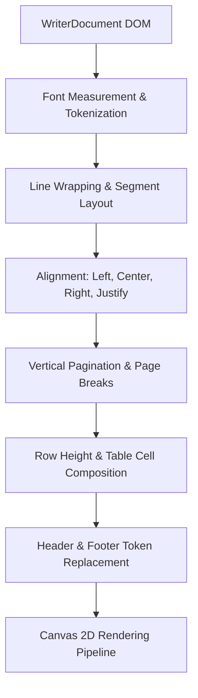
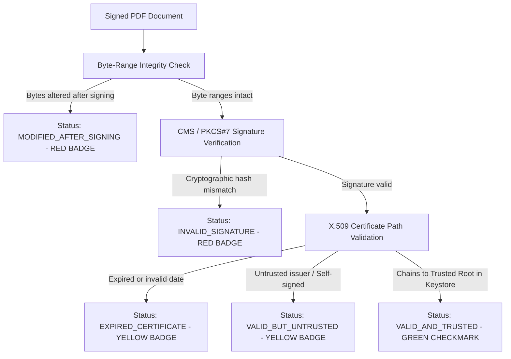

# Oqteris Architecture Specification

## 1. Architectural Overview & System Design

Oqteris is designed as a modular, decoupled desktop office suite built around clean SOLID principles and inversion of control. It guarantees 100% independence from third-party office runtimes by executing its own document parsing, internal object models, layout calculations, calculation engines, and hardware-accelerated 2D rendering pipelines.

```mermaid
graph TD
    UI[Oqteris Shell - MainWindow & Document Tabs] --> ShellServices[Shell Services: Themes, RecentFiles, Recovery, AsyncExecutor]
    UI --> DocViews[Document Views: Writer, Calc, Impress, PDF]
    
    subgraph Core Layer
        DOM[Shared Document Model & Listeners]
        Commands[Command Pattern & UndoRedoManager]
        Registry[DocumentRegistry Importers & Exporters]
        FontMgr[FontManager & Typography Engine]
        TrustStore[TrustStoreManager & PKCS#12 Keystore]
    end
    
    subgraph Applications Layer
        Writer[Oqteris Writer: LayoutEngine & Word Processor DOM]
        Calc[Oqteris Calc: CalculationEngine, Formula AST & DAG Graph]
        Impress[Oqteris Impress: Slide Model & Vector Canvas]
        PDF[Oqteris PDF: Page Renderer & Cryptographic Verifier]
    end
    
    DocViews --> Applications Layer
    Applications Layer --> Core Layer
    
    subgraph Low-Level IO & Crypto Adapters
        POI[Apache POI - OpenXML Parser/Writer Behind Interfaces]
        PDFBox[Apache PDFBox - PDF Object Parser & Fonts]
        BC[Bouncy Castle - CMS / PKCS#7 & X.509 Chain Verification]
    end
    
    Registry --> Low-Level IO & Crypto Adapters
    PDF --> PDFBox
    PDF --> BC
```

---

## 2. Shared Core Architecture

### 2.1 Shared Document Model (`org.oqteris.core.model`)
All document types inherit from `AbstractDocumentModel`, which provides standard lifecycle contracts:
- `DocumentType`: Enumerates `WRITER`, `CALC`, `IMPRESS`, and `PDF`.
- `DocumentMetadata`: Manages Dublin Core attributes (Title, Subject, Author, Keywords, Created, Modified dates).
- `DocumentListener`: Observable event notification mechanism alerting views to changes (`onDocumentModified`, `onDocumentSaved`, `onMetadataChanged`).
- `UndoRedoManager`: Implements the Command pattern. Every mutation (character insertion, cell value edit, shape movement, style change) is encapsulated in a discrete `Command` with reversible `execute()` and `undo()` operations. Supports atomic `CompoundCommand` batches.

### 2.2 Format Importers & Exporters (`org.oqteris.core.io`)
Document persistence adheres strictly to the Dependency Inversion Principle. Core application engines communicate solely with two generic interfaces:
- `DocumentImporter<T extends DocumentModel>`:
  - `canImport(File file)`: Validates file extensions and magic headers.
  - `T importDocument(File file)`: Reconstructs the internal DOM.
- `DocumentExporter<T extends DocumentModel>`:
  - `canExport(File file)`: Validates output target compatibility.
  - `void exportDocument(T document, File file)`: Serializes the DOM.
- `DocumentRegistry`: Centralized registry singleton matching files to their appropriate importer/exporter using file extensions and MIME types.

### 2.3 Cross-Cutting Shell Services
- `AsyncExecutor`: Manages a managed thread pool executing compute-heavy document parsing, line-breaking layout calculation, and cryptographic signature verification off the JavaFX UI Application thread. Safe callback handling ensures UI updates dispatch seamlessly via `Platform.runLater`.
- `AutosaveService`: Background scheduled service running on a configurable interval (default: 300 seconds). Scans open modified documents and streams backup snapshots to `~/.oqteris/recovery/`.
- `RecoveryManager`: Detects uncommitted recovery snapshots during application launch following abnormal shutdowns or crashes, prompting the user with a recovery dialog.
- `ThemeManager`: Dynamically switches CSS stylesheets between `theme-light.css` and `theme-dark.css` across all active stages and sub-views.

---

## 3. Subsystem 1: Word Processor (Oqteris Writer)

### 3.1 Document Object Model (`org.oqteris.writer.model`)
The Writer DOM represents rich text documents as a structured tree:
- `WriterDocument`: Top-level document containing global `PageSetup` (Page dimensions, margins, orientation), document elements, and headers/footers.
- `DocumentElement`: Base interface implemented by:
  - `Paragraph`: Contains a sequence of `TextRun` objects, paragraph alignment (`LEFT`, `CENTER`, `RIGHT`, `JUSTIFY`), heading style (`TITLE`, `HEADING_1`, `HEADING_2`, `HEADING_3`), line spacing, margins before/after, and list numbering.
  - `TextRun`: Atomic formatted text segment containing text content, font family, font size, bold, italic, underline, strikethrough, text color, and highlight background.
  - `DocumentTable`: Tabular structure consisting of `DocumentTableRow` and `DocumentTableCell` elements with borders and backgrounds.
  - `DocumentImage`: Embedded raster image with explicit width, height, and alignment.
  - `PageBreakElement`: Explicit hard page break trigger.

### 3.2 Typography & Independent Layout Engine (`org.oqteris.writer.layout`)
The layout pipeline does not use JavaFX controls (such as `TextArea` or `WebView`) for document composition. It computes mathematical layout independently:
1. **Font Discovery & Substitution (`FontManager`)**: Discovers installed system fonts and transparently maps proprietary Microsoft Office fonts (e.g. *Calibri*, *Aptos*, *Cambria*, *Consolas*) to available standard cross-platform fallbacks (*Segoe UI*, *DejaVu Sans*, *Liberation Sans*, *Arial*).
2. **Text Measurement & Word-Breaking**: Splits text runs into whitespace tokens and measures typographic advances via font metrics.
3. **Line Wrapping (`LayoutLine`)**: Packs words into available printable width (`pageWidth - marginLeft - marginRight`). When a word exceeds printable bounds, it breaks onto a new `LayoutLine`.
4. **Paragraph Alignment**: Justified text dynamically calculates inter-word expansion spaces; centered and right-aligned paragraphs apply coordinate offsets.
5. **Multi-Page Pagination (`LayoutPage`)**: Tracks cumulative `cursorY` against `pageHeight - marginBottom`. When an element overflows:
   - Soft page breaks create a new `LayoutPage`.
   - Headers and footers are resolved, substituting dynamic tokens (`$PAGE`, `$PAGES`).
   - Tables measure row heights and split across page boundaries when necessary.



### 3.3 Interactive Canvas View (`WriterDocumentView`)
- Renders paginated document pages onto a vertical JavaFX `Canvas` with realistic page drop-shadows and separation gutters.
- Maintains interactive caret position (`currentElementIndex`, `currentRunIndex`, `charOffset`), blinking cursor timer, and mouse hit-testing.
- Provides a comprehensive formatting ribbon for typography, alignment, bullet/numbered lists, table insertion, and page breaks.

---

## 4. Subsystem 2: Spreadsheet Editor (Oqteris Calc)

### 4.1 Workbook DOM (`org.oqteris.calc.model`)
- `Workbook`: Contains an ordered list of `Worksheet` instances.
- `Worksheet`: Sparse matrix storage mapping `(row, col)` coordinates to `Cell` objects. Manages row heights, column widths, merged cell regions (`CellRangeAddress`), and grid visibility.
- `Cell`: Represents individual grid cells with data types (`NUMERIC`, `STRING`, `BOOLEAN`, `FORMULA`, `ERROR`, `BLANK`), raw values, formula expressions, cached evaluated results, and `CellStyle` (font attributes, text alignment, borders, background fills, and number format masks).

### 4.2 Formula Engine & DAG Recalculation (`org.oqteris.calc.formula`)
- **Lexer & Parser**: Recursive descent parser converting Excel formulas (e.g. `=IF(SUM(B2:B10) > 1000, AVERAGE(C2:C10) * 1.05, 0)`) into an Abstract Syntax Tree (AST) composed of:
  - `LiteralNode` (numbers, text, booleans)
  - `CellReferenceNode` (absolute/relative cell addresses like `A1`, `$B$4`, `Sheet2!C5`)
  - `RangeReferenceNode` (cell ranges like `A1:D10`)
  - `BinaryOpNode` (`+`, `-`, `*`, `/`, `^`, `&`, `=`, `<`, `>`, `<=`, `>=`, `<>`)
  - `UnaryOpNode` (`-`, `+`)
  - `FunctionCallNode` (invokes registered functions)
- **Built-in Functions (`FunctionRegistry`)**: Over 30 standard Excel-compatible functions:
  - *Math & Trig*: `SUM`, `AVERAGE`, `MIN`, `MAX`, `COUNT`, `COUNTA`, `ABS`, `ROUND`, `SQRT`, `POWER`, `PRODUCT`, `MOD`, `INT`.
  - *Logical*: `IF`, `AND`, `OR`, `NOT`, `TRUE`, `FALSE`, `IFERROR`.
  - *Text*: `CONCATENATE`, `LEFT`, `RIGHT`, `MID`, `LEN`, `UPPER`, `LOWER`, `TRIM`, `TEXT`.
  - *Lookup*: `VLOOKUP`, `INDEX`, `MATCH`, `CHOOSE`.
  - *Date*: `TODAY`, `NOW`, `YEAR`, `MONTH`, `DAY`.
- **Topological Dependency Graph (`DependencyGraph`)**:
  - Maintained as an adjacency list mapping cells to their downstream dependents.
  - Cycle detection using Tarjan / DFS depth traversal detects circular references immediately, assigning `#CYCLE!` without thread recursion stack overflows.

```mermaid
flowchart LR
    Formula["=SUM(B2:B5) * 1.1"] --> Tokenizer[FormulaTokenizer]
    Tokenizer --> Parser[FormulaParser]
    Parser --> AST[ExpressionNode Tree]
    AST --> DepGraph[DependencyGraph - DAG Cycle Check]
    DepGraph --> EvalCtx[EvaluationContext - Worksheet Data]
    EvalCtx --> Calc[CalculationEngine - Value Evaluation]
    Calc --> Formatter[CellNumberFormatter: Currency/Percent]
    Formatter --> Grid[Virtualized Canvas Render]
```



### 4.3 High-Performance Virtualized Canvas (`SpreadsheetCanvas`)
- Renders only visible rows and columns based on current horizontal and vertical scroll offsets (`firstVisibleRow` to `lastVisibleRow`, `firstVisibleCol` to `lastVisibleCol`), achieving 60 FPS scrolling on large spreadsheets.
- Renders column headers (A, B, C...) and row headers (1, 2, 3...) with active selection highlights.
- Supports interactive column resizing, cell range dragging, and in-cell editing synchronized with the top Formula Bar.

---

## 5. Subsystem 3: Presentation Designer (Oqteris Impress)

### 5.1 Slide DOM (`org.oqteris.presentation.model`)
- `Presentation`: Slide deck with dimensions (default: 960x540 widescreen 16:9), active slide tracking, and slide management (add, remove, duplicate, reorder).
- `Slide`: Individual presentation slide with title, background fill, transition effect (`NONE`, `FADE`, `SLIDE_LEFT`, `SLIDE_RIGHT`, `ZOOM`), and shape list.
- `SlideShape` Hierarchy:
  - `TextBoxShape`: Multi-line text box with font family, size, weight, posture, text color, and alignment.
  - `GeometricShape`: Vector primitives (`RECTANGLE`, `ROUNDED_RECTANGLE`, `ELLIPSE`, `TRIANGLE`) with fill colors, border strokes, and corner radii.
  - `ImageShape`: Embedded raster bitmap with scaling and aspect ratio locking.
  - `TableShape`: Slide table with structured rows, columns, and text cells.

### 5.2 Slide Canvas & Rendering Pipeline (`SlideRenderer`)
- Independent vector graphics pipeline rendering slides onto JavaFX `Canvas`.
- Implements z-ordering operations (`bringToFront`, `sendToBack`, `bringForward`, `sendBackward`).
- Bounding-box hit testing for selection, interactive moving, and handle resizing.

### 5.3 Slideshow Mode (`SlideshowStage`)
- Full-screen hardware-accelerated presentation window triggered by `F5`.
- Slide transition effects (Fade, Slide Left/Right, Zoom) rendered using JavaFX transition animations.
- Full keyboard presentation controls:
  - Next slide: `Right Arrow`, `Down Arrow`, `Space`, `Page Down`, `N`
  - Previous slide: `Left Arrow`, `Up Arrow`, `Page Up`, `P`
  - Exit slideshow: `Escape`

---

## 6. Subsystem 4: PDF Viewer & Trust Center

### 6.1 PDF Document Rendering (`org.oqteris.pdf`)
- Integrated with Apache PDFBox 3.x behind strict rendering abstractions (`PdfDocumentModel`, `PdfPageRenderer`, `PdfPageView`).
- Multi-page continuous view with zoom presets (50%, 75%, 100%, 125%, 150%, 200%, 300%, 400%, Fit Width, Fit Page).
- Interactive navigation: page thumbnails panel, document bookmarks outline tree, and interactive text search.

### 6.2 Cryptographic Digital Signature Verification (`org.oqteris.crypto`)
The verification engine inspects embedded PDF signature dictionaries conforming to ISO 32000-1 / Adobe PPKLite:
1. **Byte Range Integrity**:
   - Parses the `/ByteRange [offset1 length1 offset2 length2]` array.
   - Computes the cryptographic digest over the specified byte ranges excluding the `/Contents` hex block.
   - Compares the byte range span with the total file length to detect any bytes appended or modified after signature generation.
2. **CMS / PKCS#7 Cryptographic Verification**:
   - Extracts the DER-encoded CMS signed data from `/Contents`.
   - Reconstructs the `CMSSignedData` object via Bouncy Castle.
   - Verifies the signer's RSA / ECDSA mathematical signature against the extracted digest and public key.
3. **X.509 Certificate Chain & Trust Store Validation**:
   - Extracts signer certificate and intermediate certificate path.
   - Validates validity timestamps (`notBefore`, `notAfter`).
   - Evaluates trust against `TrustStoreManager`:
     - Checks the application-managed PKCS#12 keystore (`~/.oqteris/truststore.p12`).
     - Optionally queries the operating system certificate store (Windows ROOT, Linux ca-certificates).



---

## 7. Performance & Threading Model

To ensure a smooth 60 FPS user interface, Oqteris strictly segregates UI rendering from expensive background computations:

| Task Category | Execution Thread | Handled By |
|---|---|---|
| **User Events & Repaint** | JavaFX Application Thread | Event Handlers, Canvas `GraphicsContext` |
| **File Import & Parsing** | Background Worker Pool | `AsyncExecutor.executeAsync()` |
| **Document Layout Calculation** | Background Worker Pool | `LayoutEngine.layout()` |
| **Spreadsheet Recalculation** | Background Worker Pool | `CalculationEngine.recalculateWorkbook()` |
| **PDF Signature Verification** | Background Worker Pool | `PdfSignatureVerifier.verifySignatures()` |
| **Autosave Snapshots** | Background Daemon Timer | `AutosaveService` |
