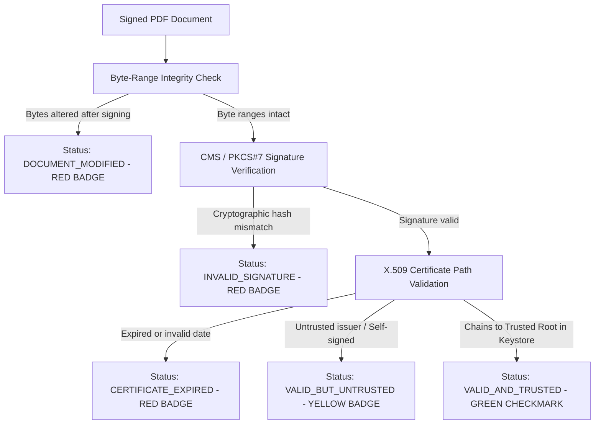
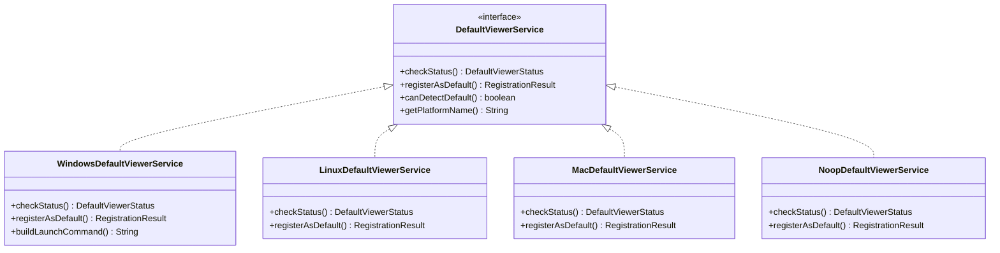

# Oqteris Architecture Specification

## 1. Architectural Overview & System Design

**Oqteris** is engineered as a dedicated desktop PDF reader and editor built on Java 21 LTS and JavaFX. The application follows clean SOLID principles, separation of concerns, and dependency inversion.

```mermaid
graph TD
    UI[Oqteris Shell - MainWindow & TabPane] --> ShellServices[Shell Services: Themes, RecentFiles, Recovery, AsyncExecutor]
    UI --> PlatformLayer[Platform Layer: DefaultViewerService & SingleInstanceManager]
    UI --> PDFView[PdfDocumentView - Ribbon, Thumbnails, Outline, Search]
    
    subgraph PDF Subsystem
        PDFModel[PdfDocumentModel - In-Memory DOM]
        PDFRenderer[PdfPageRenderer & PdfPageView]
        SigAppearance[SignatureValidityAppearance - Live Badge Rewriting]
    end
    
    subgraph Security & Cryptography Subsystem
        SigVerifier[PdfSignatureVerifier - ByteRange & CMS Parser]
        TrustStore[TrustStoreManager & PKCS#12 Keystore]
        CertManager[CertificateManagerDialog & Trust Evaluation]
    end
    
    subgraph Core Layer
        DocModel[AbstractDocumentModel & DocumentMetadata]
        Registry[DocumentRegistry & FormatDescriptor]
        Autosave[AutosaveService & RecoveryManager]
    end
    
    PDFView --> PDF Subsystem
    PDFSubsystem --> Security & Cryptography Subsystem
    PDFSubsystem --> Core Layer
    
    subgraph Low-Level IO & Crypto Adapters
        PDFBox[Apache PDFBox 3.x - PDF Document Structure & Rendering]
        BC[Bouncy Castle - CMS / PKCS#7 & X.509 Chain Verification]
    end
    
    PDFModel --> PDFBox
    PDFRenderer --> PDFBox
    SigVerifier --> BC
    SigVerifier --> PDFBox
```

---

## 2. Core Infrastructure & Shell Services

### 2.1 Shell & Window Lifecycle (`org.originsd.oqteris.ui`)
- **`MainWindow`**: Primary desktop container. Manages application menu bars, ribbon containers, document tabs, and the status bar.
- **`WelcomeScreen`**: Clean entry center providing one-click access to open files, recent PDF history, security trust management, application preferences, and drag-and-drop file opening.
- **`AsyncExecutor`**: Offloads compute-heavy document parsing, font rasterization, and cryptographic signature checking from the JavaFX UI Application Thread. Callbacks update the UI safely via `Platform.runLater`.
- **`ThemeManager`**: Manages dynamic light and dark theme switching (`theme-light.css` / `theme-dark.css`) across all active windows and dialogs.
- **`RecentFilesManager`**: Persists recently opened PDF history with last-accessed timestamps.

### 2.2 Document Model & Registry (`org.originsd.oqteris.core`)
- **`DocumentType`**: Represents the supported document type (`PDF`).
- **`AbstractDocumentModel`**: Base model providing title, modified state, Dublin Core metadata, and event listener dispatching (`DocumentListener`).
- **`DocumentRegistry`**: Central registry for format importers and exporters (`PdfImporter`).

### 2.3 Autosave & Recovery (`org.originsd.oqteris.core.recovery`)
- **`AutosaveService`**: Background daemon running at configurable intervals (default: 2 minutes) that snapshots modified documents to `~/.oqteris/recovery/`.
- **`RecoveryManager`**: Inspects the recovery directory on launch after unexpected terminations, offering users the ability to restore uncommitted sessions.

---

## 3. PDF Viewing & Rendering Subsystem (`org.originsd.oqteris.pdf`)

### 3.1 Document Model (`PdfDocumentModel`)
Wraps the underlying Apache PDFBox `PDDocument` structure:
- Extracts Dublin Core metadata (Title, Author, Subject, Keywords).
- Extracts document bookmarks (`/Outlines`) into a navigable `PdfBookmarkNode` tree.
- Inspects embedded signature dictionaries (`/V` fields) and verifies signatures on load.
- Tracks user annotations (`PdfAnnotation`) and modified state.

### 3.2 Page Rendering Pipeline (`PdfPageRenderer` & `PdfPageView`)
- **`PdfPageRenderer`**: Renders PDF pages into JavaFX `Image` objects at arbitrary zoom factors (25% to 400%). Implements an in-memory rendering cache to minimize redundant rendering passes.
- **`PdfPageView`**: Interactive page component displaying the rendered page with shadows, page borders, and highlight overlay layers for search matches.
- **Continuous Scrolling View (`PdfDocumentView`)**: Organizes pages in a vertical `VBox` inside a `ScrollPane`. Asynchronously generates page thumbnails for the sidebar drawer.

### 3.3 Visual Signature Appearance Rewriting (`SignatureValidityAppearance`)
In documents featuring visual signature stamps with layered XObjects (`n0`–`n4`), Oqteris inspects cryptographic verification results and rewrites appearance streams in memory:
- **`n1` layer**: Green checkmark (trusted), yellow question mark (untrusted), or blank (invalid).
- **`n3` layer**: Red cross (invalid/tampered), or blank.
- **`n4` layer**: Caption text indicating signature status.
This ensures visual fidelity while never modifying the PDF bytes on disk.

---

## 4. Security & Cryptography Subsystem (`org.originsd.oqteris.crypto`)

### 4.1 Digital Signature Verification (`PdfSignatureVerifier`)
Implements an uncompromising four-stage verification pipeline for Adobe PPKLite / CMS / PKCS#7 signatures:

1. **Byte-Range Tamper Detection**:
   - Parses the `/ByteRange [offset0 length0 offset1 length1]` array.
   - Enforces that the byte range starts at byte 0 and spans continuously to the end of the file (excluding `/Contents`).
   - If any bytes are appended or modified after signing, status is set to `DOCUMENT_MODIFIED` (Red Badge).
2. **CMS / PKCS#7 Cryptographic Check**:
   - Parses the DER-encoded CMS signed data container from `/Contents`.
   - Reconstructs signed content excluding the signature block.
   - Verifies the signer's public key against the signed digest using Bouncy Castle.
3. **Signing Time Resolution**:
   - Extracts signing time from authenticated attributes or embedded RFC 3161 TimeStampToken (TSP).
4. **Certificate Chain & Trust Store Validation**:
   - Builds certificate chain from signer certificate up to root.
   - Evaluates validity timestamps against signing time.
   - Checks against `TrustStoreManager`.



### 4.2 Trust Store Manager (`TrustStoreManager`)
- Application-managed PKCS#12 keystore (`~/.oqteris/truststore.p12`).
- Supports explicit trust classification (`TRUSTED`, `UNTRUSTED` / blacklisted).
- `CertificateManagerDialog` provides a graphical interface to view, import, export, and delete trusted certificates.

---

## 5. Platform Integration Subsystem (`org.originsd.oqteris.platform`)

### 5.1 Default PDF Viewer Service (`DefaultViewerService`)
Clean operating-system abstraction decoupled from UI components:



- **Windows (`WindowsDefaultViewerService`)**:
  - Registers ProgID `Oqteris.PDF` and `OpenWithProgids` in `HKCU\Software\Classes`.
  - Registers capabilities in `HKCU\Software\Oqteris\Capabilities` and `RegisteredApplications`.
  - Configures `oqteris-document.ico` as the file-type icon.
  - Queries `HKCU\Software\Microsoft\Windows\CurrentVersion\Explorer\FileExts\.pdf\UserChoice` for default detection.
  - On Windows 10/11, launches `ms-settings:defaultapps` and guides the user to confirm default application selection.
- **Linux (`LinuxDefaultViewerService`)**:
  - Installs `oqteris.desktop` desktop entry in `~/.local/share/applications/`.
  - Installs application icons in `~/.local/share/icons/hicolor/`.
  - Registers MIME association via `xdg-mime default oqteris.desktop application/pdf`.
- **macOS (`MacDefaultViewerService`)**:
  - Declares document types in `Info.plist`.
  - Guides user via Finder Get Info -> Change All or coordinates with `duti` CLI.

### 5.2 Single-Instance & IPC Lifecycle (`SingleInstanceManager`)
- Ensures that when Oqteris is launched while already running, the newly opened PDF document opens as a new tab in the existing window.
- Implements a zero-network, firewall-free file-based IPC queue in `~/.oqteris/ipc_requests/`.
- Primary instance monitors the queue and brings the window to the front upon receiving file requests.
- Secondary instances write their file arguments to the queue, await acknowledgment, and terminate cleanly.

---

## 6. Performance & Threading Model

| Task Category | Execution Thread | Handled By |
|---|---|---|
| **User Events & UI Redraw** | JavaFX Application Thread | Event Handlers, Controls, Scene Graph |
| **PDF Page Rasterization** | Background Worker Thread | `PdfPageRenderer` via `AsyncExecutor` |
| **Cryptographic Signature Verification** | Background Worker Thread | `PdfSignatureVerifier.verifySignatures()` |
| **Single-Instance IPC Monitoring** | Background Daemon Worker | `SingleInstanceManager` executor |
| **Autosave Snapshots** | Background Daemon Timer | `AutosaveService` |
