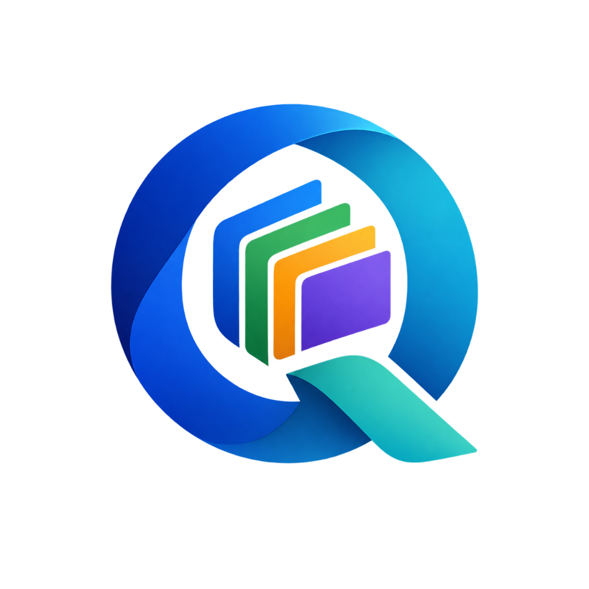

# Oqteris Office Suite

<div align="center">
  
  <h3>Independent, Cross-Platform Desktop Office Suite</h3>
  <p><strong>Java 21 LTS &bull; JavaFX 21 &bull; Apache POI 5.4.1 &bull; Apache PDFBox 3.0.5 &bull; Bouncy Castle 1.80</strong></p>
</div>

---

## 1. Overview & Vision

**Oqteris** is a modern, independent desktop office suite engineered entirely in Java 21 LTS and JavaFX. It combines four core productivity applications into a single, cohesive, tabbed desktop workspace:

1. **Oqteris Writer** &mdash; Desktop Word Processor with independent text measurement, word-wrapping, and multi-page pagination.
2. **Oqteris Calc** &mdash; Desktop Spreadsheet Editor with an independent calculation engine, directed acyclic graph (DAG) dependency tracking, circular reference detection, 30+ Excel functions, and a virtualized 2D canvas.
3. **Oqteris Impress** &mdash; Desktop Presentation Designer with vector shape canvases, z-ordering, shape styling, full-screen slideshow mode (F5), and direct PDF export.
4. **Oqteris PDF & Trust Center** &mdash; High-performance PDF Viewer with cryptographic CMS / PKCS#7 digital signature verification and an application-managed X.509 certificate trust store.

### 100% Independent Architecture Mandate

Oqteris operates completely independently:
- **Zero External Office Runtime Dependencies**: Does not launch, embed, wrap, or depend on LibreOffice, Apache OpenOffice, ONLYOFFICE, Microsoft Office, or cloud conversion services.
- **Native Document Models & Engines**: Implements its own internal document object models (DOM), layout engines, rendering pipelines, command-based undo/redo stacks, and format adapters.
- **Enterprise Security Policy**: Enforces strict cryptographic integrity; mathematical signature validity is strictly separated from Certificate Authority (CA) trust. A green badge is displayed *only* when the document is untampered and chains to an explicitly trusted root.

---

## 2. Core Applications

```
+------------------------------------------------------------------------------------+
|                                    OQTERIS SHELL                                   |
|   [File] [Edit] [View] [Insert] [Tools] [Security] [Help]     [Light/Dark Theme]   |
+------------------------------------------------------------------------------------+
|  [Tab 1: Document.docx]  |  [Tab 2: Financials.xlsx]  |  [Tab 3: Presentation.pptx]   |
+------------------------------------------------------------------------------------+
|                                                                                    |
|  +--------------------+  +--------------------+  +--------------------+  +-------+ |
|  |   Oqteris Writer   |  |    Oqteris Calc    |  |  Oqteris Impress   |  |  PDF  | |
|  | - DOCX / RTF / HTML|  | - XLSX / CSV / TSV |  | - PPTX / PDF Export|  | Trust | |
|  | - Custom Paginator |  | - DAG Recalc Engine|  | - Vector Canvas    |  | Engine| |
|  | - Table Layout     |  | - 30+ Functions    |  | - Slideshow Mode   |  | PKCS#7 | |
|  +--------------------+  +--------------------+  +--------------------+  +-------+ |
|                                                                                    |
+------------------------------------------------------------------------------------+
| Ready | UTF-8 | Autosave Active | Trust Store: 3 Certificates Loaded               |
+------------------------------------------------------------------------------------+
```

### Oqteris Writer (Word Processor)
- **Document Model**: Multi-level hierarchical tree (`WriterDocument` &rarr; `Paragraph`, `DocumentTable`, `DocumentImage`, `PageBreakElement` &rarr; `TextRun`).
- **Independent Layout Engine**: Measures typography via font metrics, computes word breaks and wrapped line segments, composes tables across column boundaries, and paginates continuous text into fixed A4/Letter pages with customizable margins, headers, and footers (`$PAGE`, `$PAGES`).
- **Interactive UI**: Multi-page vertical canvas view with blinking caret, click-to-position text navigation, typing and deletion, and formatting ribbon controls (Font Family, Size, Bold, Italic, Underline, Strikethrough, Color, Highlighting, Alignment, Lists, Table insertion).
- **Format Adapters**: Direct read/write support for Office Open XML (`.docx`), Plain Text (`.txt`), and HTML export.

### Oqteris Calc (Spreadsheet Editor)
- **Workbook Model**: Multi-sheet workbook (`Workbook` &rarr; `Worksheet` &rarr; `Row` &rarr; `Cell`) supporting cells with numeric, text, boolean, error, and formula types.
- **Calculation Engine**: Independent AST-based recursive descent formula parser and evaluation engine supporting 30+ Excel functions across mathematical (`SUM`, `AVERAGE`, `MIN`, `MAX`, `ABS`, `ROUND`, `SQRT`, `POWER`), logical (`IF`, `AND`, `OR`, `NOT`), text (`CONCATENATE`, `LEFT`, `RIGHT`, `MID`, `LEN`, `UPPER`, `LOWER`, `TRIM`), lookup (`VLOOKUP`, `INDEX`, `MATCH`), and financial/statistical domains.
- **Dependency Tracking**: Directed Acyclic Graph (`DependencyGraph`) tracks topological dependencies between cell addresses. Detects circular references immediately (`#CYCLE!`) without stack overflows.
- **Virtualized Rendering**: High-performance JavaFX 2D Canvas renders only visible cells within the viewport, supporting custom column widths, row heights, font styles, background fills, number formats (Currency `$#,##0.00`, Percentage `0.00%`, Decimals), and freeze panes.
- **Format Adapters**: Direct import and export for Office Open XML (`.xlsx`) and Delimiter-Separated values (`.csv`, `.tsv`).

### Oqteris Impress (Presentation Designer)
- **Slide Model**: `Presentation` deck containing `Slide` instances with vector shapes (`TextBoxShape`, `GeometricShape`, `ImageShape`, `TableShape`).
- **Interactive Vector Canvas**: Direct canvas manipulation with shape selection, dragging, resizing handles, z-ordering (Bring to Front, Send to Back), fill color pickers, and live text editing.
- **Slideshow Mode**: Full-screen presentation stage triggered by `F5` with keyboard navigation (Right/Left arrows, Space, PageDown/PageUp, Escape).
- **Format Adapters**: Native Office Open XML (`.pptx`) import/export preserving slide dimensions, shapes, colors, and typography, plus direct vector PDF export.

### Oqteris PDF Viewer & Trust Center
- **Independent Page Rendering**: Multi-page continuous view with zoom presets (50% to 400%), page navigation, rotation (90&deg;, 180&deg;, 270&deg;), thumbnail drawer, document outline (bookmarks tree), and text search.
- **Digital Signature Verifier**: Parses embedded Adobe PKCS#7 / CMS detached signatures (`/ByteRange`, `/Contents`), verifies cryptographic message digest integrity over the byte ranges to detect post-signing document tampering.
- **Trust Authority Engine**: Validates X.509 certificate chains, verifies validity periods, and checks trust against an application-managed PKCS#12 trust store (`~/.oqteris/truststore.p12`).
- **Security Policy**: Strictly distinguishes mathematical cryptographic validity from certificate authority trust.
  - **Green Checkmark**: Valid mathematical signature, whole-document coverage, unexpired certificate, AND chained to an explicitly trusted root certificate.
  - **Yellow Warning**: Valid cryptographic signature, but issuer is self-signed or not recognized in the trust store.
  - **Red Alert**: Cryptographic signature mismatch, altered byte ranges, or document modified after signing.

---

## 3. Technology Stack

| Component | Technology | Version | Purpose |
|---|---|---|---|
| **Runtime** | Java LTS | 21+ | Core language platform, Virtual Threads, Records, Sealed classes |
| **UI Framework** | JavaFX | 21.0.6 | Hardware-accelerated UI shell, Canvas 2D rendering, CSS styling |
| **OOXML Engine** | Apache POI | 5.4.1 | Low-level Office Open XML parsing and writing (DOCX, XLSX, PPTX) |
| **PDF Engine** | Apache PDFBox | 3.0.5 | PDF document structure, font extraction, page rasterization |
| **Cryptography** | Bouncy Castle | 1.80 / 1.80.2 | CMS / PKCS#7 signature verification, X.509 certificate path validation |
| **Build System** | Apache Maven | 3.9+ | Dependency management, multi-platform compilation, testing |
| **Test Runner** | JUnit Jupiter | 5.11.4 | Automated unit, regression, and round-trip integration testing |

---

## 4. Quick Start

### Prerequisites
- **Java Development Kit (JDK)**: OpenJDK 21 or newer installed and on `PATH`.
- **Apache Maven**: Version 3.9+ installed and on `PATH`.

Verify your installation:
```bash
java -version
mvn -version
```

### Build & Run Tests
To compile the entire codebase and execute the automated test suite (25 tests covering layout, calculation, presentation, signatures, and sample round-trips):
```bash
mvn clean test
```

### Launch the Application
Run Oqteris directly using the JavaFX Maven plugin:
```bash
mvn javafx:run
```

### Package Standalone Application JAR
Package the application into a standalone executable JAR in `target/`:
```bash
mvn clean package
```
Run the compiled JAR:
```bash
java -jar target/oqteris-office-1.0.0-SNAPSHOT.jar
```

---

## 5. Sample Documents

The project includes pre-generated, verified sample documents located in the `samples/` directory:

| File | Description | Tested Subsystem |
|---|---|---|
| `samples/sample_document.docx` | OpenXML Word document with styled headings, bullet lists, and a 4x3 table | Oqteris Writer |
| `samples/sample_sheet.xlsx` | OpenXML Spreadsheet with budget calculations, `SUM`, `IF`, and currency formats | Oqteris Calc |
| `samples/sample_presentation.pptx` | OpenXML Presentation with title slide, content bullets, and vector geometry | Oqteris Impress |
| `samples/sample_signed.pdf` | Digitally signed PDF sealed with an embedded 2048-bit RSA PKCS#7 signature | Oqteris PDF & Trust Center |
| `samples/oqteris_demo_signer.cer` | Exported X.509 certificate of the demo signer for trust store import testing | Certificate Manager |

You can open any of these sample files via **File &rarr; Open** (`Ctrl+O`) or by dragging and dropping them directly into the Oqteris window.

---

## 6. Architecture & Documentation Directory

Detailed architectural specifications, security policies, format compatibility matrices, and packaging guides are provided in the repository:

- **[ARCHITECTURE.md](file:///d:/Study/Programming/Projects/Oqteris/ARCHITECTURE.md)**: Deep dive into DOM design, layout engine algorithms, calculation DAG, rendering surfaces, and subsystem architecture.
- **[FORMAT_SUPPORT.md](file:///d:/Study/Programming/Projects/Oqteris/FORMAT_SUPPORT.md)**: Comprehensive matrix of supported document formats (DOCX, XLSX, PPTX, PDF, RTF, CSV, TXT, HTML), supported attributes, and limitations.
- **[SECURITY.md](file:///d:/Study/Programming/Projects/Oqteris/SECURITY.md)**: Cryptographic signature verification guidelines, trust store architecture, and trust decision policies.
- **[BUILD.md](file:///d:/Study/Programming/Projects/Oqteris/BUILD.md)**: Step-by-step build, testing, and native packaging procedures for Windows and Linux (`jpackage`, `jlink`).

---

## 7. License

Oqteris is licensed under the Apache License, Version 2.0. All third-party dependencies (Apache POI, Apache PDFBox, Bouncy Castle, OpenJFX) are compatible open-source libraries permitting desktop and commercial distribution.
